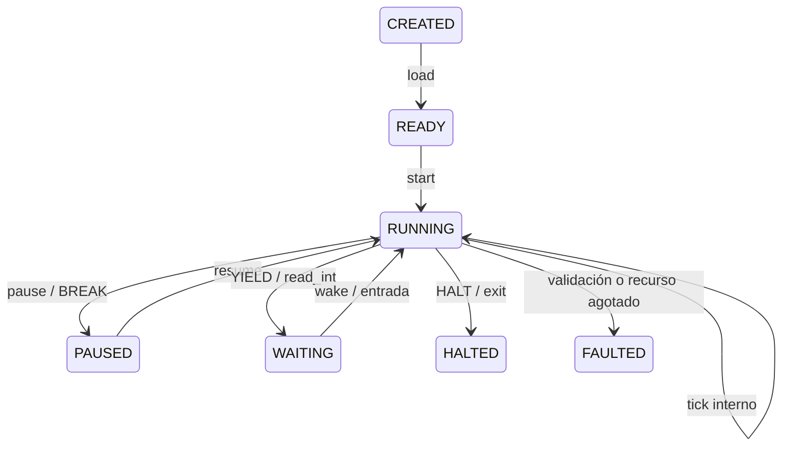

# Tramoya VM32

Tramoya VM32 es una máquina virtual RISC de 32 bits, determinista y embebible.
Está pensada para ejecutar lógica no confiable o extensible con límites claros,
no para emular eléctricamente una CPU física.

## Aplicaciones reales

- Lenguaje de scripting para videojuegos y simuladores.
- Reglas de negocio versionadas que no deben ejecutar Python arbitrario.
- Automatización determinista y reproducible.
- Plugins limitados por capacidades.
- Evaluación de código en ejercicios o retos.
- Contratos, flujos y agentes con presupuesto de ejecución.
- Lógica portable guardada como bytecode `.tvm`.
- Máquinas de control que deben pausar, esperar eventos y reanudarse.

No incorpora filesystem, red ni procesos como servicios predeterminados. Esas
capacidades solo pueden añadirse mediante syscalls explícitas del host.

## Capacidades

| Área | Implementación |
|---|---|
| Palabra | Entero con signo de 32 bits |
| Registros | 16 (`R0` cero, `R1..R14` generales, `R15` profundidad de pila) |
| Memoria | 1 048 576 palabras por defecto; configurable hasta 16 777 216 |
| ISA | 79 instrucciones de ancho fijo (4 palabras), 18 de ellas vectoriales TNU |
| Banderas | Zero, Negative, Carry y Overflow |
| Control | Saltos, llamadas, retorno, breakpoints y ejecución paso a paso |
| Pila | Protegida por límite configurable |
| FPU | IEEE 754 single-precision: `FADD`, `FSUB`, `FMUL`, `FDIV`, `FCMP`, `FTOI`, `ITOF`, `FABS`, `FSQRT` |
| Aritmética 64-bit | `MULH` (high32 de multiplicación), `ADDX`/`SUBX` (cadena de carry/borrow) |
| Fibras | Coroutines cooperativas: `SPAWN`, `SWITCH`, `FRET` (hasta 64 por defecto) |
| Interrupciones | 256 vectores, `INT`, `IRET`, `EI`, `DI` y cola externa |
| Host | Syscalls extensibles con políticas de capacidades |
| Recursos | Gas global, límite de pila, memoria, fibras y buffer de traza |
| Seguridad | Código de solo lectura, validación de PC/registros/memoria y rollback por instrucción |
| Persistencia | Snapshots paginados v2, compatibilidad v1 y bytecode con versión/CRC |
| Espera | Estado `WAITING`, entrada tardía y `YIELD` cooperativo |

## Uso

```powershell
# Programas incluidos
.\.venv\Scripts\python.exe tramoya_vm.py --demo hola
.\.venv\Scripts\python.exe tramoya_vm.py --demo factorial
.\.venv\Scripts\python.exe tramoya_vm.py --demo fibonacci
.\.venv\Scripts\python.exe tramoya_vm.py --demo array
.\.venv\Scripts\python.exe tramoya_vm.py --demo entrada --input 7 8

# Ensamblar a bytecode portable
.\.venv\Scripts\python.exe tramoya_vm.py programa.tasm --compile programa.tvm --no-run

# Ejecutar bytecode
.\.venv\Scripts\python.exe tramoya_vm.py programa.tvm

# Inspección
.\.venv\Scripts\python.exe tramoya_vm.py --demo factorial --listing --disassemble --trace

# Quitar permiso de salida
.\.venv\Scripts\python.exe tramoya_vm.py --demo hola --deny-capability io
```

Después de instalar el proyecto con `pip install -e .`, el mismo comando queda
disponible como `tramoya-vm`.

## Ensamblador

Cada instrucción ocupa cuatro palabras: opcode y tres campos. Esto simplifica la
validación, el salto aleatorio y la interpretación segura.

```asm
.code
.entry _start

_start:
        LEA R4, NUMEROS
        MOVI R2, 0
        MOVI R3, 4

BUCLE:
        LOAD R5, [R4]
        ADD R2, R2, R5
        ADDI R4, R4, 1
        SUBI R3, R3, 1
        CMPI R3, 0
        JPOS BUCLE

        MOV R1, R2
        SYSCALL 1
        HALT

.data
NUMEROS: .WORD 10, 20, 30, 40
```

Directivas disponibles:

- `.code` / `.data`: secciones ejecutable y de datos.
- `.entry ETIQUETA`: punto de entrada.
- `.equ NOMBRE VALOR`: constante.
- `.word`: datos de 32 bits.
- `.string`: texto terminado en cero.
- `.space`: reserva palabras inicializadas en cero.
- `.align`: alinea la sección de datos a una potencia de dos.

Los operandos de memoria aceptan `[R4]`, `[R4+8]`, `[R4-2]` o `[ETIQUETA]`.

## ISA

| Grupo | Instrucciones |
|---|---|
| Datos | `MOV`, `MOVI`, `LEA`, `LOAD`, `STORE` |
| Aritmética | `ADD`, `ADDI`, `SUB`, `SUBI`, `MUL`, `MULI`, `DIV`, `MOD` |
| Comparación | `CMP`, `CMPI`, `TEST` |
| Bits | `AND`, `OR`, `XOR`, `NOT`, `SHL`, `SHR` |
| Saltos | `JMP`, `JZ`, `JNZ`, `JNEG`, `JPOS`, `JLT`, `JGT`, `JC`, `JNC` |
| Pila y llamadas | `PUSH`, `POP`, `CALL`, `CALLR`, `RET` |
| Sistema | `SYSCALL`, `INT`, `IRET`, `EI`, `DI`, `SETIV` |
| Cooperación | `YIELD`, `BREAK`, `HALT`, `NOP` |
| **FPU** | `FADD`, `FSUB`, `FMUL`, `FDIV`, `FCMP`, `FTOI`, `ITOF`, `FABS`, `FSQRT` |
| **Aritmética 64-bit** | `MULH`, `ADDX`, `SUBX` |
| **Fibras** | `SPAWN`, `SWITCH`, `FRET` |
| **TNU** (capacidad `npu`) | `VCFG`, `VCOPY`, `VADD`, `VMUL`, `VSCALE`, `FDOT`, `MATVEC`, `MATTV`, `RMSNORM`, `VSOFTMAX`, `VEXP`, `VSILU`, `ROPE`, `VARGMAX`, `VSAMPLE`, `VQUANT`, `QMATVEC`, `QROW` |

`HALT` termina correctamente con código 0. La syscall 0 termina con el código
explícito guardado en `R1`.

## Syscalls incluidas

| Número | Nombre | Convención | Capacidad |
|---:|---|---|---|
| 0 | `exit` | código en `R1` | ninguna |
| 1 | `print_int` | valor en `R1` | `io` |
| 2 | `print_char` | byte bajo de `R1` | `io` |
| 3 | `read_int` | resultado en `R1`; espera si no hay entrada | `io` |
| 4 | `memory_size` | resultado en `R1` | `introspection` |
| 5 | `cycles` | resultado en `R1` | `introspection` |
| 6 | `random` | PRNG determinista en `R1` | `random` |
| 7 | `print_string` | dirección `R1`, máximo `R2` | `io` |
| 8 | `alloc` | cantidad/resultado en `R1` | `memory` |
| 9 | `memory_chip_read` | offset bytes `R1`, destino RAM `R2`, cantidad bytes `R3`; devuelve bytes en `R1` | `memory_chip` |
| 10 | `memory_chip_write` | offset bytes `R1`, origen RAM `R2`, cantidad bytes `R3`; devuelve bytes en `R1` | `memory_chip` |
| 11 | `memory_chip_size` | capacidad en bytes en `R1` | `memory_chip` |
| 12 | `npu_info` | base de la ROM TNU en `R1`, palabras en `R2` | `npu` |

Las transferencias 9 y 10 copian como máximo 4 096 bytes por llamada. En una
lectura cada byte del chip se guarda en una palabra de RAM; en una escritura se
usa el byte bajo de cada palabra fuente. Las escrituras permanecen en el chip
aunque la VM se reinicie o se restaure un snapshot; el snapshot guarda la RAM de
VM32, no el contenido del chip.

Para habilitar el dispositivo en el CLI, conecta un archivo de chip:

```powershell
.\.venv\Scripts\python.exe tramoya_vm.py programa.tasm --memory-chip chips\flash_500mb.sqlite
```

La consola web local conecta por defecto `chips/flash_500mb.sqlite`. Si se usa
otra ruta, pásala con `--memory-chip`. En una integración Python se debe adjuntar
un `NonVolatileMemoryChip` y habilitar la capacidad `memory_chip` en `VMConfig`.

Ejemplo `.tasm` para leer los primeros 16 bytes del chip en palabras consecutivas
de RAM:

```asm
.code
.entry _start
_start:
    MOVI R1, 0
    LEA R2, BUFFER
    MOVI R3, 16
    SYSCALL 9
    HALT

.data
BUFFER: .SPACE 16
```

## Integración en Python

```python
from cpu_digital import TramoyaVM32, VM32Assembler

source = """
.code
    MOVI R1, 21
    SYSCALL 100
    SYSCALL 1
    HALT
"""

program = VM32Assembler().assemble(source).program
vm = TramoyaVM32()

def duplicar(machine: TramoyaVM32) -> None:
    machine.set_register(1, machine.get_register(1) * 2)

vm.register_syscall(100, duplicar, name="duplicar")
vm.load_program(program)
result = vm.run()
assert result.output == (42,)
```

Una syscall personalizada puede:

- Leer/escribir registros mediante `get_register()` y `set_register()`.
- Acceder a memoria validada con `read_memory()` y `write_memory()`.
- Emitir datos con `emit()`.
- Suspender con `wait_for_host()`.
- Finalizar mediante `terminate()`.

Si la syscall lanza una excepción, la VM pasa a `FAULTED` y revierte los cambios
de la instrucción, incluidas escrituras de memoria realizadas por la API.

## Interrupciones

Desde el host:

```python
vm.set_interrupt_vector(1, program.symbols["ISR_1"])
vm.request_interrupt(1)
vm.run()
```

Desde la CLI:

```powershell
.\.venv\Scripts\python.exe tramoya_vm.py --demo interrupcion --vector 1=ISR_1 --interrupt 1
```

El contexto interrumpido conserva PC, banderas, estado de habilitación y la fibra
interrumpida. `IRET` lo restaura y falla si se ejecuta desde otra fibra; la
profundidad está limitada para impedir desbordamientos.

## FPU — Punto flotante

Los registros almacenan floats IEEE 754 single-precision como enteros de 32 bits.
Las instrucciones FPU interpretan los bits como float, operan y escriben el
resultado reinterpretado. Las banderas después de una operación flotante:

| Bandera | Significado |
|---|---|
| Z | Resultado es ±0.0 |
| N | Resultado es negativo |
| C | Resultado es NaN |
| O | Resultado es ±infinito |

Las banderas describen el float32 realmente almacenado (tras el redondeo): un
desbordamiento a infinito activa `O` y un subdesbordamiento a cero activa `Z`.
El desbordamiento da ±infinito con cualquier versión del host: CPython 3.13
reciente lanza una excepción al empaquetar un float32 fuera de rango, y la VM la
convierte en el infinito del signo correspondiente.
Todo resultado NaN se guarda como el **NaN canónico** `0x7FC00000` (como en
RISC-V): la carga útil que propaga el host con dos operandos NaN depende del
orden de los operandos en el código máquina, y CPython lo cambia al especializar
la operación, así que conservarla haría que el mismo programa diera resultados
distintos según cuántas veces se hubiera ejecutado.
`FCMP` compara directamente sin restar: con algún NaN, `C=1` y el resto a 0; si no,
`Z` (iguales), `N` (`a < b`), `C=0` y `O=0`.

```asm
    MOVI R1, 0x40490FDB   ; π ≈ 3.14159f
    MOVI R2, 0x40000000   ; 2.0f
    FMUL R3, R1, R2       ; R3 = π × 2 ≈ 6.2832f
    FTOI R4, R3           ; R4 = 6 (truncado)
    ITOF R5, R4           ; R5 = 6.0f
    FSQRT R6, R2          ; R6 = √2 ≈ 1.4142f
```

## Aritmética de 64 bits

`MULH` devuelve los 32 bits altos de una multiplicación con signo de 64 bits.
Combinado con `MUL` (bits bajos), permite multiplicaciones completas de 64 bits.

`ADDX` y `SUBX` usan la bandera de Carry como acarreo/préstamo de entrada,
permitiendo sumas y restas encadenadas de precisión arbitraria:

```asm
    ; 64-bit: R2:R1 + R4:R3 → R6:R5
    ADD  R5, R1, R3       ; R5 = low + low (setea Carry)
    ADDX R6, R2, R4       ; R6 = high + high + Carry
```

## Fibras cooperativas

Las fibras son hilos cooperativos ligeros dentro de una misma VM. Cada fibra
tiene sus propios registros, banderas y pila, pero comparten la memoria y el
pool de gas.

| Instrucción | Descripción |
|---|---|
| `SPAWN dir` | Crea una fibra nueva en la dirección. Su ID queda en `R1`. |
| `SWITCH Rn` | Guarda el contexto actual y carga el de la fibra `Rn`. |
| `FRET` | Termina la fibra actual y regresa a la fibra padre. |

La fibra principal (ID 0) no puede terminar con `FRET`; debe usar `HALT`.
Las interrupciones solo se despachan en la fibra principal: una interrupción externa
queda en cola mientras corre otra fibra, e `INT` fuera de la fibra 0 es un fallo.
El límite de fibras es configurable (`fiber_limit`, por defecto 64) y cuenta solo
fibras vivas distintas de la principal: al ejecutar `FRET` la fibra se retira, así
que no consume límite y `SWITCH` hacia ella falla como fibra inexistente.

```asm
.code
_start:
    SPAWN worker       ; Crear fibra → ID en R1
    MOV R2, R1         ; Guardar ID
    SWITCH R2          ; Cambiar a la fibra
    ; ... al regresar de FRET, continúa aquí ...
    HALT

worker:
    MOVI R1, 42
    SYSCALL 1          ; Emitir 42 desde la fibra
    FRET               ; Regresar al padre
```

## Chip Neuronal Tramoya (TNU)

El TNU es un coprocesador vectorial conectado a VM32 tras la capacidad `npu`
(no incluida por defecto). Sin la capacidad, o sin chip conectado, **cualquier**
opcode TNU falla sin efectos. El invitado orquesta el modelo (capas, cabezas,
caché KV, muestreo, texto); el host solo ejecuta núcleos vectoriales en C
(`math.sumprod`, `memoryview`), sin dependencias nuevas. Requiere Python ≥ 3.12.

```python
from cpu_digital import TramoyaVM32, VMConfig
from cpu_digital.tnu import TensorROM, TramoyaNeuralUnit

rom = TensorROM.from_file("models/stories260K.trom")
vm = TramoyaVM32(
    VMConfig(capabilities=frozenset({"io", "memory", "npu"}), gas_limit=10**9, trace_size=0),
    npu=TramoyaNeuralUnit(rom),
)
```

### ROM de tensores

- Ventana fija de solo lectura `[0x40000000, 0x40000000 + palabras)`, separada de
  la RAM: `MAX_MEMORY_WORDS` no cambia y los pesos no ocupan RAM. `LOAD` (también en
  bucles acelerados) y `print_string` leen la ROM (con `npu`); `STORE` y cualquier
  destino TNU en ella fallan.
- `TensorROM` copia el archivo a memoria y calcula su sha256 al abrirlo: lo que se
  usa es exactamente lo que se ha medido.
- Los snapshots **no** copian la ROM: guardan `{"sha256", "size_bytes", "path"}`.
  Restaurar exige que el host haya conectado una ROM con la misma huella; la ruta
  del snapshot (solo el nombre del archivo) es informativa y **nunca se abre**.
  `from_snapshot_bytes(..., npu=...)`. El cotejo de huella evita restaurar por error
  sobre otra ROM; no autentica el snapshot (quien lo fabrica puede omitir la clave,
  igual que puede fabricar la RAM).
- Syscall 12 `npu_info` (capacidad `npu`): `R1` = base de la ROM, `R2` = palabras.

### Modelo de ejecución vectorial

`VCFG Ra, Rb, Rc` fija `VL` (longitud o columnas, 1..2²⁴), `VR` (filas, 0..2²⁴) y
`VS` (paso entre filas en palabras; 0 = denso, igual a `VL`). Es estado del núcleo
compartido por las fibras (como la memoria), entra en el snapshot (`core.tnu`,
solo si difiere de 0,0,0) y se revierte con el registro de deshacer. Los
operandos son registros con direcciones; cada región debe caer entera en la RAM o
entera en la ROM.

| Opcode | Forma | Semántica (f32 salvo indicación) | Unidades de trabajo |
|---|---|---|---|
| `VCFG` | `Rl, Rr, Rs` | `VL, VR, VS ← Rl, Rr, Rs` | — |
| `VCOPY` | `Rd, Ra` | copia `VL` palabras (ROM→RAM o RAM→RAM) | VL |
| `VADD`/`VMUL` | `Rd, Ra, Rb` | elemento a elemento | 2·VL |
| `VSCALE` | `Rd, Ra, Rs` | `[Rd] = [Ra] · f32(Rs)` | 2·VL |
| `FDOT` | `Rd, Ra, Rb` | `Rd = f32(Σ a·b)`; banderas FPU | VL |
| `MATVEC` | `Rd, Rw, Rx` | `out[r] = Σ_j W[r·VS+j]·x[j]`, `VR` filas | max(VR·VL + 8·VR, región) |
| `MATTV` | `Rd, Rw, Ra` | `out[j] = Σ_r a[r]·W[r·VS+j]`, `VL` columnas | max(VR·VL + 8·VL, región) |
| `RMSNORM` | `Rd, Ra, Rw` | `w ⊙ a / √(mean(a²)+1e-5)` | 3·VL |
| `VSOFTMAX` | `Rd, Ra` | softmax (máximo restado, suma con `fsum`) | 5·VL |
| `VEXP`/`VSILU` | `Rd, Ra` | `exp` (desbordamiento → +inf), `x·σ(x)` (→ −0 para x muy negativo) | 4·VL |
| `ROPE` | `Rv, Rp, Rh` | RoPE de llama2.c in situ, posición `Rp`, cabeza `Rh` (par, ≤ 256, divide a VL) | 4·VL |
| `VARGMAX` | `Rd, Ra` | primer índice del máximo (con NaN, determinista pero dependiente de su posición) | 2·VL |
| `VSAMPLE` | `Rd, Ra, Rc` | primer `i` con `Σ_{≤i} p > f32(Rc)` (recorrido lineal, vale con cualquier contenido); si no, `VL-1` | 2·VL |
| `VQUANT` | `Rd, Ra` | vector Q8: `VL` bytes `q+128` y escala f32 (`VL/4 + 1` palabras) | 3·VL |
| `QMATVEC` | `Rd, Rw, Rx` | matriz Q8 (`VR·VL/4` palabras de bytes + `VR` escalas) × vector Q8 | VR·VL + 8·VR |
| `QROW` | `Rd, Rw, Rr` | fila `Rr` de una matriz Q8 descuantizada | 2·VL |

**Numérica declarada.** Cada resultado se calcula en doble precisión y se redondea
**una vez** a float32 al guardarse. `VADD`, `VMUL` y `VSCALE` coinciden bit a bit
con `FADD`/`FMUL`, salvo en la carga útil de un NaN. `FDOT`/`MATVEC`/`MATTV` acumulan con `math.sumprod` (precisión
extendida): son deterministas, pero **no** iguales a una cadena de `FMUL`+`FADD`.
Q8 usa cuantización simétrica (`round` al par más cercano, escala float32 por
fila o por vector) y productos enteros exactos. `exp`, `cos`, `sin` y `pow` vienen
de la libm del host: el resultado es determinista en una misma plataforma; la
igualdad bit a bit entre sistemas operativos no está garantizada.

**Gas.** Coste base de la ISA (1 para `VCFG`, 2 para el resto) más
`ceil(unidades / 64)`. El gas se comprueba y se cobra antes de leer o calcular;
una instrucción está limitada a 2²⁶ unidades. La calibración (µs por gas de cada
operación frente al intérprete) está en `RFC-EXP-00016.md` §P5.

**Atomicidad.** Orden fijo: permisos → parámetros → tope → gas → lectura →
cálculo → una sola escritura. La escritura guarda antes el contenido previo en el
registro de deshacer, invalida la caché de decodificación si toca código (con
`protect_code=False`) y falla si el destino es código protegido o la ROM.

### Demo: llama2.c dentro de VM32

```powershell
# 1. ROM desde un checkpoint de llama2.c (modelos de karpathy/tinyllamas, descarga manual a models/)
.\.venv\Scripts\python.exe -m cpu_digital.tnu_models models\stories260K.bin models\tok512.bin models\stories260K.trom --prompt "Once upon a time"
# 2. Generar: pasos, 1/temperatura (bits f32; 0 = voraz), semilla, n_prompt, tokens...
.\.venv\Scripts\python.exe tramoya_vm.py --demo llama2 --npu-rom models\stories260K.trom --gas 2000000000 --trace-buffer 0 --input 128 0 1 0
# 3. Benchmark E1–E4 y calibración de gas
.\.venv\Scripts\python.exe benchmarks\benchmark_tnu.py --json informe_tnu.json
```

`--quant q8` crea una ROM int8 (≈ 4× menor). La codificación BPE del prompt se
hace en el host (`tnu_models.encode`); la decodificación de piezas, el muestreo
(xorshift32 del invitado) y la parada en BOS se hacen en el invitado.

## Acelerador de bucles

`run()` compila los bucles internos calientes a funciones Python y ejecuta sus
iteraciones sin la sobrecarga por instrucción del intérprete (checkpoint,
dispatch, traza). El contrato es que el estado observable sea **idéntico** al
del intérprete: cada instrucción se genera con su misma aritmética, sus mismos
redondeos y sus mismas banderas; el gas y el presupuesto de instrucciones se
comprueban por vuelta, contra la vuelta más larga; y antes de cada instrucción
que podría fallar se comprueba que no falle. Si algo pudiera fallar (lectura
fuera de la RAM y de la ROM legible, escritura en código, en la ROM o fuera de
rango, divisor cero, raíz negativa, conversión imposible, pila llena o vacía), la
función devuelve el control al intérprete **en esa instrucción**, con el estado
parcial escrito, y el intérprete la ejecuta con su validación, su mensaje y su
rollback.

- Se acelera un bucle cuando su cabecera ha recibido 32 saltos hacia atrás
  (`LOOP_WARMUP`). Su cuerpo va de la cabecera al primer salto que vuelve a
  ella (hasta 64 instrucciones) y puede contener `MOV`,
  `MOVI`, `LEA`, `LOAD`, `STORE`, aritmética entera (con `DIV` y `MOD`), lógica,
  desplazamientos, `CMP`/`CMPI`/`TEST`, `PUSH`/`POP`, `FADD`, `FSUB`, `FMUL`,
  `FDIV`, `FSQRT`, `FABS`, `FCMP`, `FTOI`, `ITOF` y `NOP`, además de saltos hacia
  delante: dentro del cuerpo (if/else, continue) o fuera de él (salidas
  anticipadas; la última instrucción registrada es entonces ese salto).
  Llamadas, syscalls, saltos hacia atrás distintos del de vuelta (bucles
  anidados), fibras, TNU y el resto de instrucciones lo dejan en el intérprete.
- `LOAD` lee la RAM y, fuera de ella, la ROM del TNU con la misma regla que el
  intérprete (capacidad `npu` y un TNU con ROM). La ROM se consulta en cada
  entrada al código compilado, así que conectar, cambiar o desconectar el TNU
  entre dos `run()` no exige recompilar. Con subclases de `TramoyaNeuralUnit` o
  de `TensorROM`, o si las capacidades no son un `frozenset`, que podrían
  responder distinto a cada consulta, esa lectura la hace el intérprete: el
  bucle compilado le devuelve el control en ella.
- Se desactiva con traza (`trace_size > 0`), con breakpoints, con interrupciones
  pendientes, con `VMConfig(accelerate_loops=False)` o con
  `--no-loop-acceleration` en el CLI. `step()` nunca lo usa. El CLI y la consola
  activan la traza por defecto (4 096 entradas): para acelerar en el CLI hay que
  pasar `--trace-buffer 0`.
- Tampoco actúa si una subclase o la propia instancia sustituyen un manejador
  `_op_*` o un método del que depende el código generado (`_execute_one`,
  `_push`, `_add`, `write_memory`, `_read_rom_word`…): el código compilado
  reproduce la semántica de `TramoyaVM32` y no la de la extensión.
- Compilar cuesta de ~0,3 ms a ~8 ms según el cuerpo y el gas no lo cobra, así
  que se paga con instrucciones ejecutadas: cada intento de compilación aplaza
  el siguiente 1 024 instrucciones, más 256 por instrucción del bucle compilado
  (`LOOP_COOLDOWN` y `LOOP_COOLDOWN_PER_INSTRUCTION`). La espera es de la VM, no
  de cada cabecera; un intento fallido paga la parte fija, y mientras dura, un
  bucle caliente sigue en el intérprete. Las instrucciones de una entrada al
  bucle compilado cuentan doble, todas, si esa entrada ejecuta al menos tantas
  como tiene el bucle: un bucle que se usa se paga antes, y uno que sale del
  cuerpo nada más entrar, no. Así, lo que un programa puede hacer gastar al
  host compilando queda acotado por lo que ejecuta, escriba o no en su código.
  Solo la primera compilación tras cargar un programa o restaurar un snapshot
  se hace sin haber pagado nada.
- Escribir código (`protect_code=False`) invalida los bucles compilados y
  reinicia el calentamiento: cada cabecera vuelve a necesitar 32 saltos hacia
  atrás sobre el código nuevo, y compilarla otra vez se paga como cualquier
  otra compilación.
- Una excepción asíncrona del host (Ctrl+C) dentro de un bucle acelerado deja
  memoria y pila por delante de registros, pc y contadores: tras ella no se debe
  reanudar la VM ni guardar un snapshot. El intérprete tampoco revierte la
  instrucción en curso ante una excepción así, pero el acelerador amplía el daño
  a todas las vueltas de esa llamada.
- `accelerated_instructions` cuenta las instrucciones que ejecutó el acelerador
  (incluidas en `instructions`).

Medido (Python 3.13.2, Windows x64, `benchmarks/benchmark_vm32.py`): el bucle
`ADDI`+`JMP` pasa de ~557 000 a ~5,5 M instr/s; un producto punto escalar
(`LOAD`, `LOAD`, `FMUL`, `FADD`, dos `ADDI`, `SUBI`, `JNZ`) de ~55 000 a ~345 000
MAC/s. Los programas cortos y los bucles con llamadas o syscalls no cambian. Con
los pesos en la ROM del TNU, ese producto tarda 0,14–0,15 veces lo que en el
intérprete, igual que con ellos en la RAM (`benchmarks/benchmark_rom.py`). Hasta
el 2026-10-02 el código compilado devolvía el control en cada lectura de la ROM,
y con ella al principio del cuerpo el bucle tardaba de 1,16 a 1,27 veces lo que
sin acelerador. `vm_programs/llama2.tasm` no cambia: no compila ningún bucle
(los suyos llevan `CALL` u operaciones TNU) y sus lecturas de la ROM con `LOAD`
quedan fuera de bucles compilados.

En código de juego lo mide `benchmarks/benchmark_cobertura.py` sobre
`vm_programs/juego_raycaster.tasm`, un raycaster de 160×120 con 16 entidades,
colisiones, sprites con z-buffer y minimapa, escrito por un autor que no conocía
el acelerador. Con 20 frames (1,8 M instrucciones), el 85,7 % de las
instrucciones se ejecuta en bucles compilados y el programa corre 3,2 veces más
rápido, con el mismo estado final; con cuerpos solo lineales (la primera
versión del acelerador) la cobertura era del 41,4 % y la aceleración de 1,46×.
La espera entre compilaciones le cuesta 0,2 puntos de cobertura (sin ella sería
del 85,9 %): al arrancar, varios bucles se calientan a la vez y los que esperan
su turno ejecutan unas 3 800 instrucciones en el intérprete. El script desglosa
la cobertura por fase y por bucle, y estima qué aportaría cada extensión
posible simulando las reglas del acelerador sobre la traza del intérprete (la
simulación del acelerador actual reproduce exactamente la cobertura real). El
análisis está en `RFC-EXP-00016.md`, §P2.

```powershell
.\.venv\Scripts\python.exe tramoya_vm.py vm_programs\juego_raycaster.tasm --input 20 --gas 10000000 --trace-buffer 0
.\.venv\Scripts\python.exe benchmarks\benchmark_cobertura.py --frames 20
```

El coste de compilar lo miden `benchmarks/benchmark_compilacion.py` (programas
que no escriben en su código, con la configuración por defecto) y
`benchmarks/benchmark_automodificable.py` (`protect_code=False`). «Con/sin» es
el tiempo con acelerador entre el tiempo sin él; como el gas es el mismo, es
también la CPU del host por unidad de gas (Python 3.13.2, Windows x64, mediana
con `--rondas 7`). Sin escribir en código:

| Carga | Compilaciones | Con/sin | Antes |
|---|---|---|---|
| 10 bucles de 64 instrucciones y 33 vueltas (1 001 de gas) | 1 | 5,3× | 10 y 42× |
| 50 bucles iguales (5 001 de gas) | 1 | 1,9× | 50 y 41× |
| 200 bucles iguales (20 001 de gas) | 2 | 1,46× | 200 y 33× |
| Cada bucle da las vueltas que pagan la compilación anterior | 20 | 1,30× | 20 y 1,23× |
| Entre bucle y bucle, uno interpretado ejecuta lo que paga la espera | 21 | 1,23× | 21 y 1,20× |
| Lo mismo con un bucle compilado, cuyas instrucciones cuentan doble | 21 | 0,50× | 21 y 0,46× |
| La paga entrando en 30 bucles compilados que salen en su primera instrucción | 61 | 1,31× | 91 y 1,26× |
| Tras cada bucle caro, uno nuevo de dos instrucciones espera su turno | 40 | 1,21× | 40 y 0,28× |
| 200 bucles de 8 instrucciones y 33 vueltas | 6 | 1,20× | 200 y 6,1× |
| 200 bucles de 33 vueltas que no compilan | 19 | 1,27× | 200 y 3,4× |
| Ocho bucles de 400 vueltas seguidos, una ronda | 8 | 0,35× | 8 y 0,35× |
| Los mismos ocho bucles, veinte rondas | 8 | 0,12× | 8 y 0,12× |
| Sesenta bucles de 300 vueltas, una pasada | 60 | 0,36× | 60 y 0,36× |

Las diez primeras cargas son adversarias: compilan cuerpos que no usan, porque
cada cabecera sale del cuerpo nada más entrar. «Antes» es el mismo script con
el `cpu_digital` del commit `9b10b6f`, donde un programa que no escribía en su
código compilaba cada bucle a sus 32 saltos y sin espera: el coste lo acotaba
el tamaño del programa (con la memoria por defecto caben unos 3 800 bucles de
64 instrucciones), no el gas. Ahora lo acota lo que el programa ejecuta.

Las cargas cuarta a octava están ajustadas a la regla: ejecutan justo lo que
paga cada espera, cada una de una manera, así que siguen compilando todos sus
cuerpos caros. Pagar con un bucle compilado que da vueltas es lo que más
compila por instrucción ejecutada, porque esas instrucciones cuentan doble;
pero se ejecutan varias veces más deprisa y el programa sigue tardando la
mitad que sin acelerador. De las diez, y dejando aparte las tres primeras, el
peor caso medido es 1,31× (1,32× y 1,21× con Python 3.12 y 3.10).

Las tres primeras son la excepción: la primera compilación tras cargar un
programa no espera, y ellas ejecutan muy poco. Cuestan todavía más que
interpretarlas, pero es una sola compilación de más (~8 ms), que pesa menos
cuanto más ejecuta el programa.

Las tres últimas son uso legítimo y no cambian: lo que cada bucle ejecuta
compilado paga su compilación antes de que el siguiente se caliente. El precio
de la cota aparece cuando un programa compila un bucle y apenas lo usa: los que
se calientan después esperan en el intérprete hasta que esa compilación está
pagada, y alguno puede acabar antes de llegar a compilar. La octava carga es el
caso extremo, de 0,28× a 1,21×, porque compila cuerpos caros que no usa nunca.
En el raycaster son 0,2 puntos de cobertura con 20 frames y 0,9 con 5.

Con código automodificable:

| Carga | Compilaciones | Con/sin | Antes |
|---|---|---|---|
| El bucle escribe en su cuerpo en cada vuelta | 0 | 1,03× | 2 968 y 35× |
| Escribe cada 33 vueltas, cuerpo mínimo | 46 | 1,16× | 1 968 y 2,4× |
| Escribe cada 33 vueltas, cuerpo de 64 instrucciones (~8 ms por compilación) | 6 | 1,24× | 1 000 y 33× |
| Lo mismo, con un cuerpo que no compila | 100 | 1,22× | 1 000 y 2,8× |
| Un parche por ronda y un bucle de 2 000 vueltas | 30 | 0,16× | 30 y 0,15× |
| Un parche por ronda y ocho bucles de 400 vueltas | 160 | 0,35× | 160 y 0,27× |

Las cuatro primeras cargas son adversarias: escriben en su código justo cuando
el bucle acaba de compilarse. «Antes» es el mismo script con el `cpu_digital`
del commit `5e7832e`, donde cada escritura vaciaba los bucles compilados pero
no su calentamiento, y compilar no se pagaba. Con Python 3.12 y 3.10 el peor
caso es 1,32× y 1,25×.

Las dos últimas son el uso legítimo: un parche por ronda. Lo que cada bucle
ejecuta compilado paga su compilación, así que tras cada parche los bucles
vuelven a compilar en cuanto se calientan; frente a `5e7832e` solo pierden ese
calentamiento, que entonces no se repetía. Si un programa parchea su código más
a menudo de lo que tarda en pagarse una compilación, se ejecuta en el
intérprete.

```powershell
.\.venv\Scripts\python.exe benchmarks\benchmark_compilacion.py
.\.venv\Scripts\python.exe benchmarks\benchmark_automodificable.py
```

La equivalencia con el intérprete se verifica con fuzzing diferencial
(`tests/test_vm32_loops.py`: 400 bucles lineales, 800 con saltos, salidas,
`DIV`/`MOD`, `PUSH`/`POP` y FPU, 210 que parchean su propio código y 80
programas de varios bucles que esperan su turno para compilar, comparando
estado, gas, fallos, memoria, pila, registros internos, última instrucción y
snapshot, también en cada salida anticipada) y ejecutando el juego con y sin
acelerador (`tests/test_vm32_juego.py`).

## Memoria paginada y rendimiento

La RAM es lógica y dispersa: se divide en páginas de 4 096 palabras (16 KiB) y
solo materializa las páginas que reciben datos. La configuración predeterminada
expone 1 048 576 palabras (4 MiB lógicos), mientras que el máximo es 16 777 216
palabras (64 MiB lógicos). Un programa pequeño normalmente reserva una sola página.

La ejecución continua usa una ruta por lotes que conserva las transiciones finales
de Tramoya y la traza por instrucción, pero evita un `self-loop` de la máquina de
estados por cada opcode. `step()` conserva el camino totalmente instrumentado.

El código protegido se decodifica una vez al cargar. Si `protect_code=False` y una
escritura modifica una instrucción, la entrada afectada de la caché se invalida.
Los snapshots v2 guardan únicamente páginas no vacías y pueden restaurar snapshots
densos v1. La restauración es atómica: se valida todo el snapshot antes de tocar la VM.
`TramoyaVM32.from_snapshot_bytes()` nunca adopta las capacidades embebidas en el
snapshot (usa `capabilities=` o las de `VMConfig()`), y con `limits=` rechaza
snapshots cuyos límites de recursos superen los del host.

## Ciclo de vida Tramoya



Tramoya controla transiciones, hooks, historial de ciclo de vida, observabilidad,
rollback de callbacks, serialización del estado de control y exportación Mermaid.
`step()` usa la transición interna; `run()` ejecuta el bloque dentro de `RUNNING` y
solo dispara transiciones cuando cambia el ciclo de vida. La memoria y los registros
mantienen rollback por instrucción sin copiar toda la RAM.

## Modelo de seguridad

- El programa solo puede ejecutar direcciones alineadas dentro de `.code`.
- `STORE` no puede modificar código cuando `protect_code=True`.
- Registros, memoria, pila, destinos y vectores se validan en runtime, incluso
  cuando el bytecode no procede del ensamblador.
- Cada instrucción tiene coste de gas antes de ejecutarse.
- Una instrucción fallida revierte registros, flags, pila, E/S y escrituras RAM.
- Las escrituras del chip son persistentes, se confirman como transacción y no
  se revierten con una restauración de RAM o snapshot.
- Las syscalls están sujetas a capacidades del host.
- No hay acceso implícito a Python, disco, red, variables de entorno o procesos.
- El CRC detecta corrupción accidental; no sustituye una firma criptográfica.

Una syscall personalizada es código Python confiable del host. Si expone disco o
red, esa autoridad pertenece al host y debe diseñarse de forma explícita.

## Hacia un hart RV32 (RFC-EXP-00018): hito H0

[RFC-EXP-00018](RFC-EXP-00018.md) propone un hart RV32IMA_Zicsr como clase nueva
junto a VM32, que no cambia. Su hito H0 son dos experimentos que fijan las
expectativas antes de tocar el núcleo; se cerró el 2026-10-10. Lo que sigue es HECHO
medido en Windows x64 con Python 3.13.2, 3.12.6 y 3.10.11 y clang 21.1, salvo lo
marcado como PROPUESTA o CONJETURA.

### E1: cuántas instrucciones cuesta arrancar Linux nommu, y cómo son sus bloques

`benchmarks/benchmark_rv32_arranque.py` compila `benchmarks/rv32_arranque/contar.c`
(el núcleo de mini-rv32ima, commit `84858f5`, envuelto en contadores) y arranca la
imagen `linux-6.1.14-rv32nommu-cnl-1` de cnlohr (sha256 del `Image`
`5f596134…ba6c7e`) hasta el prompt del shell (`~ #`), tecleando `root` por el UART
cuando aparece `login:`. La base de tiempo del invitado va atada al recuento de
instrucciones (`-t`, instrucciones por µs de `mtime`; el DTB declara 1 MHz), sin
teclado ni reloj del host: cada cifra es determinista y dos ejecuciones dieron el
mismo recuento. Los bloques se cortan como manda P1.4 (salto, CSR, `ECALL`, `MRET`,
`WFI`, `FENCE`, trap o 32 instrucciones). CoreMark (commit `1f483d5`) se compiló con
clang para `rv32im_zicsr` y `rv32i_zicsr` con el port bare-metal de
`benchmarks/rv32_arranque/coremark` (10 y 20 iteraciones; binarios y sha256 en
`rv32_arranque/bin`, idénticos byte a byte al recompilarlos); sus CRC de lista,
matriz y estado son los esperados y la corrida de 20 iteraciones imprime «Correct
operation validated» (las de 10 solo incumplen la regla de 10 segundos de CoreMark,
porque el tick nominal es 1 MHz).

| Medida | Linux hasta `~ #`, 1 instr/µs | CoreMark rv32im | CoreMark rv32i |
|---|---|---|---|
| Instrucciones | 64 929 979 | 333 625 por iteración (23 855 fijas) | 845 940 por iteración (46 535 fijas) |
| Bloque dinámico medio (tope 32) / racha media sin tope | 6,42 / 6,81 | 4,39 / 4,46 | 4,92 / 4,95 |
| Bloques cortados por el tope de 32 | 5,7 % | 1,5 % | 0,7 % |
| Escrituras (`store` + AMO) | 24,2 % | 4,8 % | 1,9 % |
| Bloques que terminan tras una escritura | 7,9 % | 3,6 % | 1,6 % |
| Saltos condicionales tomados | 63,1 % | 50,5 % | 64,4 % |
| Páginas de 4 KiB escritas por ventana de 2²² (mediana / máximo / total) | 292 / 567 / 1 888 de 16 384 | 3 / 3 / 3 | 3 / 3 / 3 |

Con bases de tiempo más rápidas (4, 16 y 64 instrucciones por µs) el arranque baja a
50 231 146, 47 255 745 y 46 580 290 instrucciones, porque hay menos interrupciones
del temporizador (6 787 entradas en `mtvec` frente a 932), y la mediana de páginas
sucias por ventana queda en 304–313. La mezcla del arranque es 36,8 % aritmética,
21,9 % cargas, 24,1 % `store`, 8,8 % saltos condicionales, 3,0 % `jal`, 2,5 % `jalr`,
1,9 % `lui`/`auipc`, 0,5 % extensión M, 0,3 % CSR y 0,1 % AMO; 841 `ecall`; el 1,8 %
de las instrucciones corre en modo U. El 55 % de los bloques tiene cuatro
instrucciones o menos, el 80 % ocho o menos y el 94 % veinticuatro o menos.

Veredictos de E1 (umbrales del RFC §5): el arranque está muy por debajo de 10⁹
instrucciones, así que H3 mantiene Linux nommu como meta, y por debajo de 2,6·10⁹ con
una mediana de páginas sucias del 1,8 % de la RAM (umbral 10 %), así que P5 (el
núcleo nativo certificado por ventanas) sigue en pie; la casilla F6 del mapa tiene
cifra. CONJETURA: a los 0,55 M instr/s del intérprete de VM32, 65 M instrucciones son
unos dos minutos; la velocidad real del hart la mide E3.

### E2: carriles de bytes sobre la memoria paginada y anillo de deshacer

`benchmarks/benchmark_rv32_memoria.py` mide, sobre `PagedMemory` sin tocarla, dos
formas de leer y escribir bytes: la que describe el texto de P1.1 (extraer el byte
de la palabra con desplazamiento y máscara; escribir por lectura-modificación-
escritura) y una `memoryview` de bytes por página, sin copia sobre el mismo
`array('i')`. Cada acceso comprueba el rango y resta la base `0x80000000`. Las cifras
son el mínimo de 7 rondas de 200 000 accesos sobre datos aleatorios, netas del coste
de llamar a un método vacío de la misma aridad (la lectura más severa) y frente a la
palabra alineada por vista `I`, que es el camino que tendrá el hart (la mitad del
coste del `PagedMemory[...]` actual); cada operación se contrasta antes con un modelo
`bytearray` (107 666 comprobaciones, con los cruces de página, los límites de la RAM
y valores negativos forzados, sin `assert`), y dos revisores independientes, uno
metodológico y otro con un oráculo matemático propio (471 564 comprobaciones, 61 de
63 mutantes muertos), pasaron dos veces por el script. El ruido de la medida es de
±0,05× en los cocientes y de ±3 puntos en el anillo; un caso base repetido al final
derivó entre −1,4 % y +1,2 %.

| Cociente neto frente a la palabra alineada | 3.13 | 3.12 | 3.10 |
|---|---|---|---|
| `lb` / `lw`, vista de bytes | 0,81× | 0,79× | 0,86× |
| `lbu` / `lw`, vista de bytes | 0,64× | 0,63× | 0,71× |
| `sb` / `sw`, vista de bytes | 0,73× | 0,71× | 0,74× |
| `lb` / `lw`, desplazamiento y máscara | 1,30× | 1,30× | 1,69× |
| `sb` / `sw`, lectura-modificación-escritura con máscaras precalculadas (texto de P1.1) | **1,50×** | **1,52×** | **1,56×** |
| `lh` / `lw` y `sh` / `sw`, vista de bytes | 1,34× / 1,21× | 1,37× / 1,22× | 1,51× / 1,27× |
| `lw` desalineada (`int.from_bytes`) / `lw` | 1,99× | 2,08× | 2,11× |
| `lw` por vista / `lw` actual de `PagedMemory` (bruto) | 0,49× | 0,45× | 0,42× |
| `memcpy` por bytes / por palabras, por instrucción | 0,90× | 0,92× | 0,95× |
| Anillo de solo escrituras `(dirección, valor anterior)`, memcpy/strcpy | +9…+10 % | +7…+9 % | +12…+13 % |
| Anillo que deshace instrucciones `(pc, destino, valor anterior)` | +24…+26 % | +24…+26 % | +31…+32 % |

Veredictos de E2 (umbrales del RFC §5): la vía que describe el texto de P1.1 queda en
el umbral de 1,5× con la mejor implementación medida (sobrevive por 0,002 en 3.13 y
muere en 3.12 y 3.10; recalculando la máscara en cada acceso daba 1,69–1,79× y moría
en las tres); la vía de vistas de bytes por página cuesta menos que la palabra en las
tres versiones y sobrevive con holgura. Las medias palabras por vista quedan en
1,34–1,51× y la palabra desalineada en ~2×; el RFC no les fija umbral (son
decisiones de la implementación). El anillo que deshace instrucciones está en el
umbral del 25 % en 3.13 y 3.12 y por encima en 3.10 (cota superior, porque el
intérprete mínimo no decodifica desde memoria ni atrapa): se retira y queda snapshot
más reejecución, como ya proponía P1.10; el anillo de solo escrituras es barato pero
no tiene uso en el diseño de comprobar-y-confirmar.

**Decisión del 2026-10-10 (P1.1 y P1.10 enmendados en el RFC).** Antes de redactar
P1.1 con vistas por página se buscó una alternativa que anulara sus desventajas (caché
de vistas que reconstruir al restaurar, materialización a mano, página ausente y
cruce de página en el camino caliente, granularidad de 16 KiB): la RAM del hart entera
en un `mmap` anónimo, con tres vistas `B`/`I`/`i` sobre el único búfer y un mapa de
bits de páginas de 4 KiB escritas que cada `store` marca. El sistema operativo
materializa cada página al tocarla (0 MiB residentes al crear 64 MiB; +8,1 MiB tras
escribir 1 900 páginas al azar; un `bytearray` de 64 MiB compromete los 64 MiB al
crearse), las vistas son función del búfer (nada que inventariar en P2.5), no hay
páginas ausentes ni cruces, y el snapshot guarda solo las páginas marcadas (exacto
mientras toda escritura pase por la capa; un escaneo completo costaría 125 ms y
comprometería toda la RAM). Medido con `--plana` (mismo protocolo; la RAM contigua
incluye el mapa de bits en cada `store`, que las vistas por página no llevan y
necesitarían igual para la generación de P1.6):

| RAM contigua / vistas por página (neto) | 3.13 | 3.12 | 3.10 |
|---|---|---|---|
| `lw` / `lb` / `lbu` | 0,73× / 0,65× / 0,59× | 0,78× / 0,69× / 0,64× | 0,65× / 0,60× / 0,53× |
| `lh` / `lhu` / `lw` desalineada | 0,71× / 0,72× / 0,77× | 0,77× / 0,74× / 0,77× | 0,70× / 0,63× / 0,70× |
| `sw` / `sb` / `sh` (con mapa de bits) | 0,98× / 0,93× / 1,06× | 0,97× / 0,95× / 1,09× | 0,88× / 0,92× / 1,08× |

Lo que no anula: la hipótesis de host little-endian con palabras de 4 bytes (se
comprueba al arrancar) y la regla de que el host escriba en la RAM del hart solo por
la capa; añade liberar las vistas antes de cerrar el `mmap` y que la memoria residente
crezca también con las lecturas, acotada por la RAM. Se eligió esta alternativa.

**No cubierto por H0.** E1 mide una sola imagen (6.1.14 nommu de cnlohr, 64 MiB) y
solo hasta el prompt, con el emulador de referencia, no con el hart; las entradas en
`mtvec` se estiman por el `pc`; la CI no compila `contar.c` ni ejecuta E1 (necesita
clang y las descargas), aunque sí comprueba los sha256 de los binarios. E2 es un
microbanco, no el intérprete real: no mide materializar páginas al vuelo ni fallos de
la caché de vistas, solo un tamaño de anillo (4 096), sin CSR en el anillo, con la
máquina al 0–10 % de carga y con CPython 3.13.2, no el 3.13.15 de la CI.

### H1: hart RV32I, bloques compilados y horizonte (E3)

Siete módulos nuevos en `cpu_digital/` (2 206 líneas) y seis de pruebas (2 151), sin
tocar VM32: `rv32_isa` (tablas y codificador de RV32IMA, Zifencei, Zicsr, `MRET` y
`WFI`: 68 instrucciones más `ILLEGAL`), `rv32_decode` (decodificador que nunca lanza y
desensamblador con los alias de `llvm-objdump`: las 3 194 instrucciones del CoreMark
versionado salen idénticas al desensamblado dorado, y las diferencias con objdump fuera
de él son una lista cerrada de cuatro clases documentada en el módulo), `rv32_alu`
(funciones y plantillas de expresión equivalentes, con cada operando evaluado una sola
vez), `rv32_mem` (la RAM contigua de P1.1: `mmap` anónimo, vistas `B`/`I`/`i`,
generaciones monótonas por página de 4 KiB y snapshot v2 de las páginas escritas),
`rv32_hart` (intérprete comprobar-y-confirmar de RV32I más la lectura de los contadores
de Zicntr, caché de decodificación por página y generación, paradas con `mcause` y
`mtval`), `rv32_platform` (bus con recorte al ancho del acceso, UART 8250 mínimo, SYSCON,
CLINT y `Machine`) y `rv32_blocks` (compilador de bloques básicos a funciones Python con
salida lenta única, volcado de los registros escritos, invalidación por generación y
horizonte de gas).

CoreMark rv32i (`coremark_rv32i_zicsr_it10.bin`, 10 iteraciones, clang 21.1) corre en el
hart hasta el apagado por SYSCON con 8 505 937 instrucciones confirmadas (las 8 505 936
que contó mini-rv32ima en E1 más la escritura en SYSCON, que el emulador de referencia
no cuenta) y los mismos cuatro CRC en los tres modos de E3
(`benchmarks/benchmark_rv32_coremark.py`, código final del hito; máquina al 1–21 % de
carga; mínimo de 3 rondas; 378 bloques compilados, 99,95 % de las instrucciones en
bloques en los dos modos acelerados):

| Modo | 3.13.2 | 3.12.6 | 3.10.11 |
|---|---|---|---|
| Intérprete comprobar-y-confirmar | 3,80 s · 2,24 M instr/s | 3,49 s · 2,44 M | 4,33 s · 1,96 M |
| Bloques sin horizonte | 1,17 s · 7,27 M | 1,08 s · 7,90 M | 1,20 s · 7,10 M |
| Bloques con horizonte (gas exacto) | 1,18 s · 7,19 M | 1,10 s · 7,74 M | 1,23 s · 6,90 M |
| Bloques con horizonte / intérprete | 3,21× | 3,18× | 3,52× |
| Coste del horizonte | +1,0 % | +2,1 % | +2,9 % |

Veredictos de E3 (§5 del RFC): el intérprete queda en 1,96–2,44 M instr/s según la
versión de Python, por encima de los 0,4 M que matan P1 (y de los 0,55 M del intérprete
de VM32); los bloques con horizonte van 3,18–3,52× más rápido que el intérprete (umbral
2×); el horizonte cuesta del 1 al 3 % frente a los bloques sin él (se retiraba si pasaba
del 10 %): el gas queda exacto en la frontera de instrucción. La meta informativa de
5,5 M instr/s se supera en el CoreMark entero (bloques de 5,7 instrucciones de media,
mediana 4). P1 sobrevive. Una primera versión del compilador (vistas, base y máscaras
como argumentos y globales; carga de todos los registros usados) dio 2,03× con la
máquina al 100 % por otros procesos y no vale como medida; la versión medida liga las
vistas como argumentos por defecto, pone `base`, `size` y las máscaras como literales
(plegado de constantes), calcula el desplazamiento como `(rX + (imm − base)) & M` con una
sola guarda `o ≤ size − ancho`, carga solo los registros leídos antes de escribirse,
comprueba las generaciones en línea en el bucle del hart y trata la caída de una rama no
tomada como punto de control.

Método (forja): especificación previa por módulo (`.forja/h1/spec_*.md`), construcción
aislada, revisión ciega por un segundo agente y oráculo matemático independiente con
generadores y mutantes propios; cada módulo difícil con dos revisiones ciegas sucesivas.
Hallazgos corregidos antes de integrar: el centinela de página de la caché de
decodificación (−1) coincidía con la «página −1» y un fetch en [base − 4096, base − 4]
ejecutaba la última página de la RAM con un resultado que dependía de los cortes de gas
(bloqueante, hallado a la vez por el revisor ciego y por el oráculo del hart); el bus no
recortaba al ancho del acceso (un `lb` del CLINT dejaba un registro de 33 bits y un `sb`
con 0x5555 apagaba la máquina); `Machine` no pasaba el divisor de tiempo al hart; las
generaciones bajaban en `reset`/`restore_pages` (una caché podía resucitar una
decodificación vieja); las plantillas con signo evaluaban el operando dos veces;
`FENCE.I` con campos reservados se rechazaba (el manual manda ignorarlos); el alias
`blt zero, zero` no era el de objdump; `pc + 4` no envolvía en la última palabra del
espacio. Los mutantes de los revisores (ALU 70/70, ISA 94 %, hart 24/33, bloques 20/30
abatidos por las pruebas) señalaron los huecos que las pruebas nuevas cierran: código
automodificable sobre instrucciones ya ejecutadas (misma página, otra página, `sb`/`sh`
parciales, `sh` que cruza a la página de un bloque, segunda página de un bloque de dos),
destino constante desalineado, tope exacto de 32, calentamiento, cargas anchas en el
último byte de la RAM, mitades altas de los contadores, `attach_memory`. La revisión ciega
del compilador optimizado midió además un límite de recursos: un bucle con sus datos en
la página de su propio código invalidaba y recompilaba el bloque en cada vuelta (19 999
compilaciones; 29× más lento que el intérprete) y cada bloque retenía 10,5 KB, 3,9 de
ellos de texto fuente. Desde entonces un pc se recompila como mucho 8 veces
(`MAX_RECOMPILATIONS`) y después se interpreta hasta `reset`/`attach_memory`, el hart no
retiene el texto generado (`keep_block_sources`, apagado por defecto) y la caché de
bloques tiene tope de 4 096 entradas (`MAX_BLOCKS`, unos 18 MB) que al llenarse se vacía
entera, como la de QEMU; la segunda revisión ciega del compilador (30 000 programas de
fuzz propio y 69 776 casos de bordes, 0 divergencias) y la segunda del hart (0 defectos
de corrección; 7 menores de plataforma, aplicados: `load_flat` mide bytes y no borra nada
si la imagen no cabe, un solo divisor de tiempo entero para `rdtime` y el CLINT, accesos
que sobresalen de una ventana MMIO fallan enteros, sub-palabras de `mtime`/`mtimecmp`)
cerraron el ciclo de revisión de ambos módulos.

**Embench IoT 1.0 en el hart** (`benchmarks/benchmark_rv32_embench.py`; etiqueta
`embench-1.0`, commit 0466a18e, zip con sha256 1a28cf01…; soporte de placa propio en
`benchmarks/rv32_arranque/embench/`: disparador por el CSR `cycle`, UART, apagado por
SYSCON, mínimo de libc y rutinas de 64 bits para rv32i; binarios rv32i_zicsr versionados
con su sha256 y reproducibles byte a byte). 14 de los 19 benchmarks compilan y enlazan
con clang en rv32i; cubic, minver, nbody, st y wikisort necesitan soft-float, que no
existe para riscv32 sin compiler-rt, y quedan fuera. Los 14 verifican su resultado
(`verify_benchmark`) y dan el mismo recuento en los tres modos. Dos pasadas de 2 rondas,
con la máquina al 35–42 % por otros procesos del usuario, coinciden en ±1 %:

| Benchmark | Instrucciones | Intérprete | Bloques con horizonte | Ratio |
|---|---|---|---|---|
| aha-mont64 | 19,48 M | 2,34 M/s | 9,49 M/s | 4,05× |
| crc32 | 7,36 M | 2,27 M/s | 11,08 M/s | 4,89× |
| edn | 69,17 M | 2,31 M/s | 8,45 M/s | 3,66× |
| huffbench | 2,90 M | 2,21 M/s | 6,12 M/s | 2,77× |
| matmult-int | 36,04 M | 2,32 M/s | 8,87 M/s | 3,82× |
| nettle-aes | 3,66 M | 2,18 M/s | 8,92 M/s | 4,09× |
| nettle-sha256 | 4,77 M | 2,22 M/s | 6,90 M/s | 3,11× |
| nsichneu | 2,01 M | 1,89 M/s | 3,37 M/s | 1,79× |
| picojpeg | 4,80 M | 2,09 M/s | 6,21 M/s | 2,97× |
| qrduino | 6,33 M | 2,25 M/s | 7,30 M/s | 3,25× |
| sglib-combined | 5,58 M | 2,24 M/s | 7,40 M/s | 3,30× |
| slre | 2,77 M | 2,02 M/s | 5,20 M/s | 2,58× |
| statemate | 1,52 M | 1,96 M/s | 4,89 M/s | 2,50× |
| ud | 17,15 M | 2,41 M/s | 12,01 M/s | 4,99× |

Media geométrica 3,30× (mínimo 1,79× en nsichneu, una máquina de estados de bloques de
una o dos instrucciones donde manda el coste de entrar en el bloque; máximo 4,99× en ud);
intérprete mínimo 1,89 M instr/s; coste mediano del horizonte +1,6 %. Leídos con los
umbrales de E3, que aquí son informativos, sobreviven.

**Coste de la invalidación por página (P1.6), medido.** Los binarios versionados alinean
`.data` y `.bss` a una página de 4 KiB (`embench/link.ld`, la disposición que da
cualquier cargador con MMU). Enlazados con el `link.ld` de CoreMark, que empaqueta los
datos tras el código (`--ld empaquetado`), cuatro benchmarks tienen sus datos calientes
en la misma página que su código: cada store a esos datos saca al bloque por la guarda de
página propia, sube la generación y lo invalida, hasta agotar el tope de recompilaciones
y quedar interpretados. huffbench pasa de 2,77× a 1,03× (39 % de las instrucciones en
bloques; 760 recompilaciones y 94 puntos de control en el tope), nettle-sha256 de 3,11× a
1,54× (69 %), sglib-combined de 3,30× a 1,79× (84 %) y ud de 4,99× a 2,09× (86 %); la media
geométrica baja de 3,30× a 2,66×. Es el precio de la granularidad de página que P1.6
aceptó para no depender del almacén. PROPUESTA para H2: un mapa de palabras de código por
página (un byte por palabra decodificada o compilada); un store a una palabra que no es
código no sube la generación, solo marca la página como escrita para el snapshot, y uno a
una palabra de código sale al intérprete, que invalida como hoy. Cambia `rv32_mem`
(separar «escrita» de «generación») y la guarda de los stores en los bloques; no cambia
la semántica del invitado. CoreMark no lo sufre (sus datos calientes no comparten página
con su código caliente). La propuesta se prototipó en una copia aislada
(`.forja/h2/investigacion-p16.md`, diff en `.forja/h2/prototipo-p16.diff`): con líneas de
16 bytes, la media geométrica de Embench empaquetado pasa de 2,66× a 3,30×, la misma que con
los datos alineados (ud de 2,09× a 4,82×), y CoreMark no cambia (3,20×). Queda pendiente de
la decisión del usuario para H2.

**No cubierto por H1.** Los cinco benchmarks de Embench con coma flotante (sin soft-float
para riscv32). El hart ejecuta RV32I y la lectura
de los contadores: M, A, escrituras de CSR, traps, interrupciones, `MRET` y `WFI` son
instrucción ilegal hasta H3 (E3 usa el binario rv32i). El tiempo es `instret` (P3 llega
en H4). No hay snapshot del hart ni invariante S todavía (H2). E3 se midió en una sola
máquina con CPython 3.13.2 (la CI usa 3.13.15 y 3.10) y 3 rondas; los recuentos son
deterministas, los tiempos no. El desensamblador solo nombra los 23 CSR que la
plataforma conoce. La tercera revisión ciega de ISA/decode (1,3 millones de palabras
idénticas a objdump salvo la lista cerrada) dejó hallazgos solo de fuerza de pruebas y de
docstring; la cuarta revisión ciega (1,6 millones de palabras frente a un decodificador
propio, 198 mutantes) tampoco encontró defectos de comportamiento y sus nueve menores de
documentación y pruebas se aplicaron. El coste de compilar bloques no se cobra a gas
(materia de P3). Los traps y la invariante S quedan para H2 y H3.

### H2: snapshot del hart, invariante S y conformidad (E4, E5)

H2 empieza por el refinamiento de P1.6 que H1 dejó medido como PROPUESTA; los pasos
siguientes (snapshot y restauración del hart, invariante S bajo cortes, riscv-tests y
ACT4) se documentan en este mismo apartado a medida que cierran. Todo lo que sigue es HECHO
salvo lo marcado.

**H2.0: mapa de líneas de código de 16 bytes (enmienda de P1.6, aprobada el 2026-10-11,
integrada el 2026-10-12).** La invalidación por generación de página de 4 KiB hacía que
cualquier store a datos que compartieran página con el código caliente invalidara sus bloques
(y la caché de decodificación de la página): con Embench enlazado con los datos pegados al
código, la media geométrica bajaba de 3,30× a 2,66× y huffbench a 1,03×. Antes de tocar el
código se reinvestigó el prototipo de H1 en reposo, con dos rondas (Embench) y tres (CoreMark)
y cinco tamaños de línea (`.forja/h2/investigacion-p16.md`, evidencia en
`.forja/h2/reinvestigacion-p16/`): con líneas de 64 y 32 bytes `ud` seguía al 85,5 % de
cobertura porque su variable caliente `chkerr` está a 20 bytes del fin de `.text`; con 16
bytes los 14 benchmarks empaquetados igualaban al alineado (3,38× frente a 3,33×); con 8
bytes no se ganaba nada (3,39×) y el mapa doblaba su tamaño. En los 14 binarios, con 16
bytes, un solo store de 3,35 millones cae en una línea de código (la escritura única de
`seed` en `ud`). Decisión del usuario: 16 bytes.

Diseño (`cpu_digital/rv32_mem.py`, `rv32_hart.py`, `rv32_blocks.py`; especificación en
`.forja/h2/spec_p16_lineas_codigo.md`): `Rv32Memory` separa tres estados derivados.
`written` (un byte por página) dice si la página recibió alguna escritura desde la creación
o el último `reset` y es lo único que el snapshot mira (invariante: byte ≠ 0 ⇒ página
escrita); `code` (un byte por línea de `LINE_BYTES` = 16, la única constante que fija el
tamaño) dice si alguna palabra de la línea entró en una caché derivada (el hart la marca al
decodificar y `compile_block` marca las líneas del bloque antes de usarlo); `generations`
(monótonas) sube solo con los stores del invitado que tocan una línea marcada (todas las
páginas que el store toca), con toda escritura del host (`load_bytes`, `fill`,
`restore_pages`, `reset` sobre las páginas que borra) y con `clear_code`, que al desmarcar
sube la generación de las páginas que tenían marcas para que ninguna caché construida antes,
de este hart ni de otro que comparta la memoria, sobreviva al vaciado. En el hart, `sb`/`sw`
y el `sh` que no cruza línea marcan `written` y suben la generación solo si la línea tiene
código; el `sh` que cruza línea va por la vía lenta, que mira las dos líneas y sube las dos
páginas si hace falta. En los bloques, la guarda de store deja de ser «página propia» y pasa
a ser «línea sin código» (`not code[o >> 4]`), con `written[o >> 12] = 1` en vez de
`gens[o >> 12] += 1`: un store sobre una línea con código sale al intérprete, que invalida
como hoy. Nada cambia en la semántica del invitado, en el formato de snapshot v2 ni en VM32.

Cifras sobre el código integrado (máquina en reposo, bajo un Job Object, mínimo de 3 rondas
en CoreMark y de 2 en Embench; CoreMark rv32i de 10 iteraciones; Embench 1.0, 14 benchmarks,
todos verificados y con el mismo recuento en los tres modos; `.forja/h2/cifras_h2_0/`):

| Medida | H1 (P1.6 por página) | H2.0 (líneas de 16 B) |
|---|---|---|
| CoreMark, bloques con horizonte / intérprete | 3,14× | 3,23× |
| Embench empaquetado, media geométrica | 2,66× | 3,37× |
| huffbench / nettle-sha256 / sglib-combined / ud empaquetados | 1,00× / 1,59× / 1,75× / 2,13× | 2,92× / 3,27× / 3,33× / 4,75× |
| Embench empaquetado, mínimo (nsichneu) y siguiente (slre) | 1,00× / 2,72× | 1,81× / 2,63× |
| Embench alineado a página, media geométrica | 3,33× | 3,32× |
| Intérprete, media geométrica en empaquetado | 2,07 M instr/s | 2,19 M instr/s |
| Memoria del mapa por 64 MiB de RAM | 0 | 4 MiB (`bytearray`, residente al crearlo) |

Criterios de H2.0 (prompt): empaquetado ≥ 3,0× y ningún benchmark bajo 1,5× salvo nsichneu
(3,37×; mínimo de los demás 2,63×), CoreMark y alineado dentro de ±3 % (+2,9 % y −0,3 %):
se cumplen. El store de un bloque es además más barato que antes (leer un byte del mapa y
poner otro cuesta 77 ns frente a los 108 ns del `+= 1` sobre `array('Q')`, en 3.13).

Método (forja): especificación con criterios ejecutables, construcción en copia aislada,
banco de maestranza, oráculo matemático independiente (155 000 operaciones de memoria
contra un modelo propio y 8 520 ejecuciones del hart en cinco variantes, argumento por casos
del invariante «toda palabra cacheada tiene su línea marcada y toda escritura posterior
cambia su generación», 38 mutantes) y tres revisiones ciegas sucesivas (45, 70 y 57 mutantes;
3 250 programas × 6 modos; 48 000 carreras con hasta cuatro harts sobre una memoria; 7 155
escenarios con `restore_pages` sin reiniciar el hart y `load_flat` con cachés calientes;
11 975 ejecuciones idénticas entre H1 y H2.0). Hallazgos corregidos antes de integrar: vaciar
el mapa desde `attach_memory`/`reset` desprotegía las cachés de otro hart sobre la misma
memoria (ahora `clear_code` sube las generaciones); doce mutantes de comportamiento sobrevivían
a la suite (marcar después de ejecutar, `_sb` consultando otra línea, el bloque ligando una
copia del mapa, stores sin marcar `written`, la segunda página de un store que cruza sin
marcar); la tercera disposición del fuzz de bloques no ejercitaba ningún store sobre código;
un `load_bytes` que marcara un byte de menos sobrevivía; `reset` sin cubrir el último byte de
página y `mark_code` desalineado sin cobertura; dos docstrings y un comentario imprecisos. La
suite rv32 pasa de 108 a 135 pruebas (seis reescritas a la semántica nueva; el resto nuevas:
frontera línea/código, nueve programas en seis modos frente al intérprete de referencia, fuzz
hostil, invariantes comprobados en cada ejecución del diferencial, dos harts compartiendo
memoria, bordes de página del host), en 3.13 y 3.10; 366 en total. Desviación declarada: la
regla «se integra cuando la segunda ciega no encuentra nada nuevo» no se cumplió a la primera
(las ciegas 2 y 3 hallaron huecos de pruebas y de documentación, ningún defecto de código); se
aplicaron y se integró sin una cuarta ciega.

**No cubierto por H2.0.** El mapa se materializa entero al crear la memoria (RAM/16: 4 MiB
por 64 MiB; una RAM grande y poco tocada pierde ahí la pereza del `mmap`). Un invitado que
intercale datos calientes a menos de 16 bytes de su código paga la vía lenta en esos stores
(correcto, más lento; no ocurre en CoreMark ni en Embench). Varios harts sobre una misma
memoria son coherentes, pero cada vaciado del mapa de uno cuenta como una invalidación para los
bloques de los demás y consume su tope de recompilaciones; `Machine` tiene un solo hart. El
coste de compilar sigue sin cobrarse a gas (P3). Las cifras son de una máquina con CPython
3.13.2.

**H2.1: snapshot y restauración del hart (P2.5, P2.3; integrado el 2026-10-19).** `Rv32Hart.snapshot()`
devuelve el estado arquitectónico y el contenido de la RAM en un diccionario serializable en JSON: registros,
`pc`, `instret` (64 bits; `run` envuelve el contador al terminar y `time`, `timeh` y `mtime` se calculan sobre el
contador envuelto, como los contadores de Zicntr), `csrs` (vacío en H2: los contadores se derivan de `instret` y
del divisor; H3 añade los de modo M con claves `"0x300"`), `reservation` (`null` hasta H3), `time_divisor`
(estado del invitado: fija `time` y `mtime`; el constructor solo admite [1, 2⁶⁴), el dominio del snapshot) y las
páginas escritas en el formato paginado v2 de VM32 con la geometría de la RAM; `Machine.snapshot()` añade el UART
(salida y cola de entrada) y `mtimecmp`. No lleva el gas (lo fija el arnés en cada `run`), ni la configuración
(`accelerate`, `horizon`, `warmup`, `max_blocks`, `keep_block_sources`, el bus), ni las cachés ni las estadísticas.
`restore` valida todo antes de tocar nada (claves exactas por nivel, tipos estrictos, rangos, `x0 = 0`, geometría de
la RAM igual a la conectada, páginas validadas por `restore_pages`; toda lista se copia antes de validarse y cada
valor se lee del diccionario una sola vez, de modo que lo validado es exactamente lo que se restaura aunque el objeto
cambie entre lecturas) y lanza `ValueError` dejando la máquina intacta; al confirmar vacía la caché de decodificación,
los bloques, el calentamiento, las recompilaciones y el mapa de código (`clear_code` sube la generación de las
páginas marcadas y `restore_pages` la de las restauradas y borradas, así que ninguna caché anterior, de este hart o
de otro sobre la misma memoria, puede coincidir), conserva la lista `regs` y la cola del UART (como `reset`) y no
toca la configuración, el gas ni las estadísticas. `state_hash()` es el sha256 de la serialización canónica del
snapshot (claves ordenadas, sin espacios), estable entre procesos: con él el arnés de E4 compara máquinas sin
igualar diccionarios. `snapshot_bytes()` / `restore_bytes()` / `Machine.from_snapshot_bytes()` envuelven el JSON con
la receta de VM32 (firma `RV32S\x01`, zlib de nivel 9, tope de 256 MiB descomprimidos, rechazo de flujos truncados o
con bytes de más; `from_snapshot_bytes` crea la máquina con la geometría del snapshot, rechaza una RAM mayor que
`max_ram_bytes` (64 MiB por defecto) antes de reservarla y cierra la máquina si la restauración falla por cualquier
causa, incluida una interrupción). `Machine` recuerda el divisor con que se construyó y `load_flat` lo repone (un
`restore` adopta el del snapshot); `Uart.reset` sustituye la salida por un `bytearray` nuevo, así que una vista
exportada por el host no deja la máquina a medias.

Puerta de inventario (P2.5): cada clase con `__slots__` de los módulos `rv32_*` (`Rv32Hart`, `Rv32Memory`, `Uart`,
`Clint`, `Bus`, `Syscon`, `Machine` y `Block`) declara `STATE_FIELDS` (entran en el snapshot), `DERIVED_FIELDS`
(campo → regla de invalidación, con palabras), `CONFIG_FIELDS`, `STATS_FIELDS` y `HARNESS_FIELDS` (`gas`); las
pruebas descubren los módulos `rv32_*` con `pkgutil` y las clases con slots (también vacíos) por introspección,
exigen que cada slot esté en exactamente una lista con su regla, fijan la clasificación exacta de cada campo,
comprueban que las instancias no tienen `__dict__`, que toda subclase de una clase inventariada declara sus slots,
que ninguna clase inventariada tiene atributos de clase de tipo mutable y que cada campo de estado del hart,
perturbado, aparece en el snapshot y cambia el hash: un slot nuevo sin clasificar, un módulo nuevo sin listar o un
campo de estado nuevo sin su perturbación ponen la suite en rojo. Lo que la puerta no ve (límite de una puerta
declarativa, medido por la ciega 3 con siete evasiones): estado fuera de los slots (una variable de módulo, un
cierre, un atributo de clase inmutable reasignado, un dispositivo definido en otro módulo adjunto al bus) y el uso
semántico de un campo clasificado como estadística o derivado; de esas evasiones, las pruebas de la invariante S
cazaron las que `run` leía (cuatro de siete) y las otras tres (dispositivos nuevos con estado) solo las ve la
revisión de cada paso: un dispositivo con estado tendrá que entrar en `Machine.snapshot` y en el inventario en H3.

Precondición de la invariante S: `run` con gas exacto (`horizon=True`, el valor por defecto). Sin horizonte, cuánto
rebasa cada `run` depende de qué bloques estén compilados y de los contadores de calentamiento, que no son estado
del invitado.

Pruebas (`tests/test_rv32_snapshot.py`, 62): ida y vuelta por diccionario, bytes y constructor; máquina usada con
cachés, calentamiento, recompilaciones y mapa calientes sobre otro código en las mismas direcciones; rechazo atómico
de más de ochenta snapshots malformados y de bytes corruptos, truncados (también solo en el tráiler de zlib), con
bytes de más, con otro byte de versión o con anidamiento sin fondo, comprobando identidad y contenido de las
cachés, estadísticas, gas, mapa, generaciones y páginas escritas; objetos hostiles que cambian entre validar y usar;
restauración fallida que no toca divisor, reserva ni registros; los 32 registros y todas las claves CSR validados;
no adopción de la configuración y adopción del divisor; el mismo snapshot con intérprete, bloques y cortes; formato
v2 aceptado por `PagedMemory`; hash fijado como literal calculado en otro proceso y sensibilidad a cada campo de
estado; inventario (puerta, tabla fijada, descubrimiento de módulos y clases, subclases de prueba que la puerta
señala, perturbación por campo); la invariante S acotada sobre 80 programas aleatorios y hostiles y los programas
ancla de H2.0 con las ocho combinaciones de aceleración y calentamiento en origen y destino, en hart nuevo y usado;
un programa con UART, `mtimecmp` y apagado con todos sus cortes; `pc` desalineado o fuera de la RAM; `instret` que
envuelve y `time`/`mtime` iguales con y sin corte al cruzar 2⁶⁴; divisor de 64 bits; CoreMark en ocho trozos con
restauración por bytes alternando bloques e intérprete (recuento y CRC de E1, mismo hash que entero).

Método (forja): especificación (`.forja/h2/spec_snapshot_hart.md`, v4 tras las revisiones), construcción en copia
aislada, banco de maestranza, oráculo matemático independiente (argumento por casos S0–S3 con el AST y un espía
dinámico de todo lo que `run` lee, demostración con el código de que ninguna caché anterior puede coincidir tras
restaurar, modelo propio y 163 500 operaciones de fuzz, 46 mutantes) y tres revisiones ciegas sucesivas (ciega 1:
≈ 49 300 casos con corte, 121 457 restauraciones encadenadas, 63 mutantes, 45 snapshots malformados más; ciega 2:
fuzz propio sin divergencias, 88 mutantes de uno en uno, nueve ataques a la puerta de inventario; ciega 3: ≈ 81 000
restauraciones en cinco familias de fuzz con `instret` alto, RAM en los bordes del espacio y cortes dentro de bloques
de dos páginas, 95 variantes de JSON bruto, 34 mutantes, siete evasiones de la puerta). Ningún defecto bloqueante
de alcance general; la ciega 3 encontró una divergencia real de alcance estrecho: con `instret` a menos de un corte de
2⁶⁴ (solo alcanzable restaurando un snapshot casi saturado) y divisor ≠ 1, `time`, `timeh` y `mtime` diferían entre
la máquina sin cortar (contador sin envolver) y la restaurada; corregido (`run` envuelve el contador y los relojes
dividen el contador envuelto) y anclado. Otros hallazgos corregidos antes de integrar: `Machine.restore` dejaba
estado parcial si el host tenía una vista exportada sobre la salida del UART (ahora la salida se sustituye por un
`bytearray` nuevo, también en `load_flat`); `instret` y `time_divisor` sin cota superior (ahora 64 bits) y un
constructor que aceptaba divisores que el snapshot no podía restaurar; `load_flat` tras un `restore` conservaba el
divisor del snapshot; `Block` fuera de la puerta de inventario y la puerta sin fijar la clasificación exacta, sin
descubrir módulos nuevos, subclases sin slots, clases con slots vacíos ni atributos de clase mutables, y con la
perturbación de la reserva vacía; el validador releía listas y escalares en varias rutas (UART, páginas, `pc`,
`instret`, `version`, `regs`, geometría): un objeto hostil podía colar un valor sin validar o dejar la RAM borrada con
una excepción que no era `ValueError`; varias grafías para una misma clave de CSR; un tope negativo que descomprimía
sin límite y un tope enorme que lanzaba `OverflowError`; `TypeError` en vez de `ValueError` con claves de más
incomparables y con `max_ram_bytes` inválido; restaurar en una máquina cerrada; y medio centenar de mutantes de
fuerza de pruebas anclados con las pruebas propuestas por los revisores. Límites documentados: `restore` acepta
páginas válidas no canónicas y `snapshot` devuelve la forma canónica; un JSON con claves repetidas se interpreta como
`json.loads`; el tope de 256 MiB acota los bytes descomprimidos, no la memoria del JSON cargado (unas diez veces más
en el peor caso medido); una RAM densa de 1 MiB da 3,0 MiB de JSON (la RAM densa restaurable es ≈ 85 MiB); el nivel
8 de zlib produce los mismos bytes que el 9 en todos los tamaños medidos.

**H2.2: la invariante S bajo cortes (E4; ejecutado el 2026-10-19).** `benchmarks/benchmark_rv32_invariante.py`
ejecuta cada programa de cuatro formas: el intérprete sin cortes (referencia), los bloques troceados en los cortes
sin restaurar con calentamiento 1 y 2 (hash de estado en cada corte, que localiza la primera divergencia; cobertura
y compilaciones de referencia de cada calentamiento) y, por modo (intérprete, bloques con calentamiento 1 y 2), la
cadena: en cada corte `snapshot`, restauración en otra máquina y continuación, alternando como destino una máquina
nueva (nacida con el divisor de tiempo predeterminado: adopta el del snapshot) y la máquina usada de la iteración
anterior (cachés, bloques y mapa del tramo anterior del mismo programa), pasando una de cada diez veces por
`snapshot_bytes`/`restore_bytes`; además, una **sonda que ejecutó el programa entero** (cachés, bloques, mapa y
páginas escritas del final: lo que una restauración sin `reset` o con cachés vivas dejaría ver) recibe el mismo
snapshot en cada corte (uno de cada cincuenta en los programas de más de 100 000 instrucciones), se compara con el
origen y vuelve a ejecutar hasta el final; en cada corte de los programas cortos (uno de cada veinticinco en los
largos) se comprueban los invariantes de H2.0 (decodificaciones y bloques vigentes con sus líneas marcadas y
coincidentes con la memoria, byte ≠ 0 ⇒ página escrita) y la ida y vuelta de las páginas; y tras cada restauración se
comprueba que la configuración del destino no cambió. Cortes uniformes y sesgados: una pasada de perfil con bloques,
calentamiento 1 y **sin horizonte** (así el intérprete solo ejecuta lo que un bloque no puede) en trozos de 1
instrucción (programas de hasta 100 000) o 64 anota las ventanas en que sube la suma de generaciones (store sobre
código), cambian la salida o la cola del UART o `mtimecmp` (MMIO) o el intérprete ejecuta algo (salida lenta,
instrucción no traducible); los cortes sesgados caen dentro de esas ventanas, en sus bordes y de 1 a 4
instrucciones antes del inicio y después del final. Cada programa corre con un divisor de tiempo propio (1, 3, 7,
1 000 y, en las anclas de tiempo, 2⁶⁴ − 1, 2³² + 5 y 70 001) y el corpus del CLI incluye catorce programas ancla
(parches sobre el propio código, tope de recompilaciones, datos en la página del código, MMIO con cola de entrada
del UART, `mtimecmp` de 64 bits releído con `mtime` por MMIO, una palabra por grupo de snapshot, salida larga del
UART, CSR `time`/`timeh` con divisores extremos), CoreMark, los 14 de Embench y programas aleatorios y hostiles con
registros iniciales al azar.

Resultado oficial (2026-10-19, desde el repositorio integrado, máquina en reposo: carga del 5–11 % antes de
empezar, bajo un Job Object; 1 000 cortes uniformes y 1 000 sesgados por programa; CoreMark rv32i, los 14 binarios de
Embench, los 14 programas ancla y 200 aleatorios y hostiles de 64 KiB; tres modos; 62 min;
`.forja/h2/cifras_h2_2/invariante_e4.json`): **0 divergencias** en 229 programas × 2 000 cortes × 3 modos (en los
programas cortos, cada corte alcanzable: 743 por plan en las anclas, 17 008 en los aleatorios y 2 219 en los hostiles;
`hostil-35` muere en su primera instrucción y no tiene cortes). CoreMark tiene 85 ventanas de eventos (CSR y UART):
923 de los 1 000 cortes sesgados caen en ventana frente a 0 de los uniformes; los Embench, 4–6 (los disparadores por
el CSR `cycle` y la salida por el UART al principio y al final): 677 frente a 1 de 14 000; en los aleatorios, 11 796
frente a 9 196 de 17 008, y en los hostiles 1 948 frente a 1 944 de 2 219 (sus ventanas cubren casi todo el
programa). Clases de ventana: 154 programas solo con salidas lentas, 63 con stores sobre código y 18 con MMIO. Un
`snapshot()` + `restore()` cuesta 1,55 ms en CoreMark y de 0,8 a 1,6 ms en Embench (1 MiB de RAM), 4,7 y 1,8–6,2 ms
por bytes (zlib 9), y 0,25–0,32 ms en los programas de 64 KiB; el trabajo completo del arnés por corte (dos hashes,
dos copias observables, comprobaciones), de 3 a 7 ms con 1 MiB y 1,5–1,8 ms con 64 KiB. Una restauración vacía el
calentamiento y recompila los puntos calientes del tramo siguiente: en CoreMark con calentamiento 1, 23,4
compilaciones por restauración con cortes uniformes y 9,4 con sesgados (la cobertura de bloques no baja: 0,9995 en la
cadena y sin restaurar); con calentamiento 2, 17,2 y 6,1, y la cobertura baja de 0,999 a 0,980 porque un bloque
necesita dos llegadas al mismo pc dentro del tramo (con 1 000 cortes en 1,5–20 M de instrucciones el tramo es corto:
en `nettle-sha256` y `nsichneu` la cobertura con calentamiento 2 cae a 0,19 y 0,44, mientras con calentamiento 1 se
mantiene en 0,997–0,9996). Veredicto de E4 (§5 del RFC): no aparece ninguna divergencia, así que no hay nada que
curar con un checkpoint por instrucción ni con un coste dependiente de la partición: P1 (y P3) sobreviven.

Pruebas (`tests/test_rv32_invariante.py`, 47): 48 programas aleatorios y hostiles con 12 cortes por plan y todas las
comprobaciones en cada corte; los catorce programas ancla con **todos** sus cortes en los tres modos; el perfil
localiza ventanas de código (también en la última página), salida lenta y MMIO (también un programa que solo escribe
`mtimecmp`) y los cortes sesgados caen en ellas; la comprobación derivada detecta sus cuatro clases de error y no
repone marcas; sensibilidad del arnés (con `mock.patch`: restauración sin `reset` de la RAM, `instret` desplazado,
divisor no adoptado, `mtimecmp` no restaurado, cachés vivas con generaciones quietas, cola olvidada por el snapshot,
gas mal informado tras restaurar, configuración adoptada al restaurar, error que solo aparece con calentamiento 2 y
contadores heredados: todos divergen; el núcleo intacto, no); anclas de los mutantes del propio arnés (cortes no
alcanzados, hashes del primer y último corte, plan de cortes y ventanas a ±4, plan sesgado solo con ventanas,
destino usado y ruta por bytes, cronómetros, estadísticas por tramo, ventana simétrica, valores por defecto,
divisores rotatorios, referencia sin bloques, memorias cerradas también si `restore` lanza, ida y vuelta de páginas);
`statemate` con 64 + 64 cortes; CoreMark con 48 + 48. Revisión: dos ciegas sucesivas del arnés
(`.forja/h2/revision_arnes_invariante.md`, `revision_arnes2_invariante.md`): la primera encontró seis hallazgos
importantes (un divisor de tiempo nunca ejercitado, un `restore_pages` sin `reset` invisible para la máquina usada,
de ahí la sonda entera, el MMIO fuera del corpus del CLI, el modo con calentamiento 2 casi vacío con su línea base
tomada del 1 y un cronómetro que no medía la restauración); la segunda, cuatro mutantes del núcleo que el corpus no
veía (`mtimecmp` truncado, `mtime` con el divisor de construcción, divisor truncado, salida truncada a 64 bytes) y
22 mutantes del arnés vivos en la suite, cerrados con seis anclas y dieciséis pruebas. Límites: el corte 0 y el
corte N no se planifican; la adopción del divisor solo se ejercita en los destinos nuevos; el sesgo no está
estratificado por clase (las salidas lentas dominan); `compilaciones_por_restauracion` depende del plan y se cita por
plan; la cifra de coste de un corte es `ms_snapshot_restore`, no `ms_por_corte` (que incluye hashes, copias y
comprobaciones del arnés).

**H2.3: riscv-tests rv32ui enteros y fragmentados, y mutantes de restauración (E5; ejecutado el 2026-10-19).**
`benchmarks/benchmark_rv32_riscv_tests.py` ensambla los 42 tests `rv32ui` de `riscv-software-src/riscv-tests`
(commit `d7e86f70`, sha256 del zip fijado en el módulo) con un entorno propio (`benchmarks/rv32_arranque/riscv_tests/
riscv_test.h` y `link.ld`: `TESTNUM` en `gp`, `RVTEST_PASS` escribe `0x5555` en SYSCON, `RVTEST_FAIL` manda el
número del caso por el UART y escribe `0x7777`; los `rv32ui/*.S` son envoltorios de `rv64ui`, que se incluyen), los
instala versionados en `bin/` con su sha256 y los ejecuta enteros (veredicto: apagado sin salida) y fragmentados con
`verify_program` (64 cortes uniformes y 64 sesgados, tres modos, sonda entera). Resultado oficial (2026-10-19, desde el repositorio integrado; `.forja/h2/cifras_h2_2/riscv_tests_e5.json`): los
42 pasan enteros (apagado por SYSCON sin salida) y los 42 fragmentados con 64 cortes uniformes y 64 sesgados por
plan en los tres modos sin divergencias (de 7 a 929 instrucciones por test; dos ventanas de eventos por test; 121 s
en total). `benchmarks/
benchmark_rv32_mutantes.py` aplica 20 mutantes de restauración errónea sobre una copia del árbol (campo presente pero
mal restaurado: registros, `pc`, `instret`, divisor, RAM, UART, `mtimecmp`; cachés y mapa vivos; generaciones
quietas, descendentes o `written` sin recalcular; última página omitida; y tres combinaciones), filtra la vivacidad
en dos capas (los catorce programas ancla y doce aleatorios, y la propia batería del detector, con todos los cortes y
restauración en máquina nueva y usada con aceleración distinta en origen y destino) y mide si el fragmentador de
riscv-tests los detecta con cortes uniformes y con sesgados. Resultado oficial (2026-10-19, desde el repositorio integrado, 64 min; `.forja/h2/cifras_h2_2/mutantes_e5.json`):
la base limpia pasa la sonda (7 314 comprobaciones generales y 22 860 en la batería) y el detector no ve nada (0 y 0).
De los 20 mutantes, **6 están vivos en la batería** (registros sin restaurar o desplazados, `pc` e `instret` sin
restaurar, `instret` + 1, RAM sin restaurar) y el fragmentador **detecta los 6** (100 %, criterio ≥ 90 %), tanto
con cortes uniformes como con sesgados (divergencias por mutante, uniformes/sesgados: 6 987/9 255, 5 001/4 356,
10 212/10 512, 30 042/30 078, 30 132/30 132, 630/630). Ocho mutantes están vivos solo en el corpus general (divisor
no adoptado, salida y cola del UART, `mtimecmp`, `written` sin recalcular, último grupo de páginas omitido y dos
combinaciones de cachés vivas con generaciones quietas): los tests rv32ui no tocan dispositivos, tiempo ni esos
patrones de memoria, así que la batería no puede observarlos (límite de cobertura de los programas, no del
fragmentador; esos mismos mutantes los detectan las anclas del arnés de E4, `HarnessSensitivity` y
`SecondHarnessReview`). Seis son equivalentes: ninguna sonda los distingue porque el mecanismo de generaciones
(`clear_code` y `restore_pages` las suben) neutraliza cachés, bloques y mapa vivos y generaciones quietas o
descendentes. Veredicto de E5 (§5 del RFC): la primera cláusula se supera con holgura (100 % frente al 90 %); la
segunda («los cortes sesgados superan a los uniformes») **no se cumple: empatan** (6/6 mutantes cada plan; en
divergencias contadas, 84 963 sesgadas frente a 83 004 uniformes, un 2,4 % más, con tres mutantes a favor del sesgo,
uno en contra y dos iguales). La razón está en los datos: los tests rv32ui tienen dos ventanas de eventos cada uno
(los CSR de arranque y la parada) y 64 cortes cubren casi todo un programa de 7 a 929 instrucciones, y los eventos
que el sesgo persigue (stores sobre código, MMIO) son justo los que la restauración protege por construcción (los
mutantes de cachés resultan equivalentes). Es una cifra asesina alcanzada por empate: se presenta como está, sin
rebajar el umbral; lo que queda en duda no es el fragmentador (P2.1, P2.2 enteros y fragmentados, P2.5) sino la
premisa de que el sesgo de cortes aporta detección, y decide el usuario (enmendar E5/P2 para dejar el sesgo como
opción, o diseñar mutantes y programas que solo fallen en ventanas de eventos).

**H2.4: riscv-arch-test 2.7.4 rv32i_m/I con firmas (E5; ejecutado el 2026-10-19).** `benchmarks/benchmark_rv32_act.py`
ensambla los 38 tests de `rv32i_m/I` de ACT 2.7.4 (sha256 del zip fijado; las versiones 3.x exigen RISCOF y no traen
referencias planas) con `benchmarks/rv32_arranque/act/model_test.h` y `link.ld` (`RVMODEL_HALT` apaga por SYSCON), lee
las direcciones `begin_signature`/`end_signature` con `llvm-nm` y fija por test el sha256 de la referencia Sail en
`act/SIGNATURES.sha256`; cada test corre entero con la RAM que necesite (`jal-01` mide 1,75 MB) y su firma se compara
palabra a palabra con la referencia; después, fragmentado con `verify_program` (64 + 64 cortes). Resultado oficial (2026-10-19, desde el repositorio integrado; `.forja/h2/cifras_h2_2/act_e5.json`): las 38 firmas
coinciden con la referencia enteros (de 76 a 6 808 instrucciones por test; firmas de hasta 588 palabras) y los 38
fragmentados con 64 cortes uniformes y 64 sesgados por plan en los tres modos no divergen (una ventana de eventos por
test: la parada por SYSCON; 908 s en total; `jal-01` necesita 2 MiB de RAM por sus saltos largos).

**Propuesta: `accelerate=True` por defecto (PROPUESTA; la decide el usuario).** Con la invariante S probada con
bloques en E4 y E5 (0 divergencias con bloques, calentamiento 1 y 2, destino nuevo, usado y sonda entera), el RFC
pide proponer la activación por defecto con la cifra. Cifra: los bloques con horizonte van 3,23× (CoreMark) y 3,37×
(Embench empaquetado, media geométrica) más rápido que el intérprete con gas exacto (H2.0), el horizonte cuesta del 1
al 3 % frente a los bloques sin él (H1), y una restauración cuesta recompilar los puntos calientes del tramo
siguiente (23,4 compilaciones por restauración en CoreMark con calentamiento 1 y cortes uniformes, 9,4 con
sesgados; de 4 a 428 en Embench según el programa; la cobertura no baja con 1 000 cortes). Lo que no cambia con el valor por defecto: la semántica
del invitado, el gas, el formato de snapshot y los tests, que ya ejecutan los dos modos. Hasta la decisión,
`accelerate=False`.

**No cubierto por H2.1–H2.4.** El hash incremental por store de P2.3 (opcional, solo diagnóstico) no se implementó.
El bus y sus dispositivos no entran en el snapshot (H3 lo extenderá con las interrupciones del CLINT). `horizon=False`
queda fuera de la invariante S por diseño. El perfil clasifica como MMIO solo los accesos que cambian el estado del
dispositivo (una lectura de `mtime` o del LSR sale del bloque y cuenta como salida lenta) y no sitúa el evento dentro
de la ventana de 64 instrucciones de los programas grandes. rv32um/ua/mi y ACT `privilege` llegan con H3 (M, A,
Zicsr, traps). Los tiempos por corte son de una máquina con CPython 3.13.2; los recuentos son deterministas. `WFI` y
`mtimecmp` como eventos de temporizador llegan con H3.
## Límites honestos

VM32 ya es utilizable como runtime embebido, pero no es una CPU física, un sistema
operativo ni una sandbox aislada a nivel de proceso. Es de un solo hilo lógico
(las fibras son cooperativas, no paralelas), no tiene JIT ni recolector de basura.
Para ejecutar código adversarial de alto riesgo conviene además colocar el proceso
Python dentro de un contenedor o sandbox del sistema operativo.
